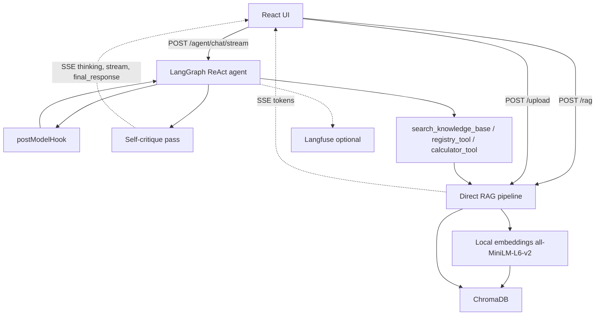

# Ethereal Intelligence

A document-grounded RAG chatbot and a tool-using LangGraph agent, built as a portfolio project to demonstrate practical AI engineering: local embeddings, a custom tool-loop breaker, and a self-critique pass.

**Live demo:** TODO — add a hosted URL here.

## What it does

The React UI (`frontend/src/hooks/useChat.js`) exposes two modes:

- **RAG mode** — retrieve chunks from ChromaDB and answer only from that context, with source attribution and a heuristic confidence score.
- **Agent mode** (default) — a LangGraph ReAct agent that can search the knowledge base, list uploaded documents, or run a sanitized calculator, then send the draft answer through a self-critique pass.

### Implemented in this repository

- **RAG pipeline** (`backend/src/services/ragService.js`): `RecursiveCharacterTextSplitter` (chunk size 1000, overlap 200), top-5 similarity search with a 0.20 score threshold, and dictionary-based query expansion (`backend/src/services/queryExpander.js`).
- **Local embeddings + ChromaDB**: `Xenova/all-MiniLM-L6-v2` via `@langchain/community` Hugging Face Transformers embeddings; persistent collection `chatbot_knowledge` (cosine space). Chroma runs in Docker. Documents can also be ingested at runtime through `POST /upload`.
- **LangGraph ReAct agent** (`backend/src/agents/mainAgent.js`): `createReactAgent` with three tools:
  - `search_knowledge_base` — `backend/src/tools/ragSearchTool.js`
  - `registry_tool` — `backend/src/tools/registryTool.js`
  - `calculator_tool` — `backend/src/tools/calculatorTool.js` (input is sanitized; the expression is then evaluated with `new Function`)
- **Loop-breaker and tool-call repair** — `postModelHook` in `backend/src/agents/mainAgent.js` (see below).
- **Self-critique pass** — `backend/src/services/selfCritiqueService.js`, invoked from `backend/src/services/agentService.js`.
- **SSE streaming** — in RAG mode, tokens are streamed as the model produces them (`answerWithRagStream`). In agent mode the flow is two-phase: the graph is invoked to completion, then the critiqued answer is streamed. The events the backend actually emits are `thinking`, `stream`, and `final_response`.
- **Prompt-level grounding** — anti-hallucination instructions in the RAG system prompt when context is missing or below the similarity threshold.
- **Optional Langfuse traces** — the `langfuse-langchain` callback in `agentService.js` is used when the Langfuse environment variables are set.
- **Session memory** — LangGraph `MemorySaver` keyed by `thread_id`. This is in-memory only and does not survive a process restart.

An LLM-as-a-judge helper (`evaluateRagResponse` in `ragService.js`) can score answer faithfulness, and a route is declared in `backend/src/routes/ragRoutes.js`, but **`server.js` does not mount `POST /rag/evaluate`**, so it is not reachable in the running app.

## Stack

| Layer | What this repository uses |
| --- | --- |
| Frontend | React 19, Vite, Tailwind CSS 4 (`frontend/`) |
| Backend | Express 5, Node 20 (`backend/server.js`) |
| Agent | LangGraph `createReactAgent` (ReAct) |
| LLMs | Groq. Agent default: `llama-3.1-8b-instant` (`GROQ_MODEL` in `mainAgent.js`). Self-critique default: `llama-3.1-8b-instant` (`GROQ_CRITIQUE_MODEL`). Direct RAG pipeline: `llama-3.3-70b-versatile` (hardcoded in `LLM_CONFIG` inside `ragService.js`, not an env var). |
| Embeddings | Local `all-MiniLM-L6-v2` (Xenova / ONNX) |
| Vector store | ChromaDB (Docker), collection `chatbot_knowledge` |
| Observability | Optional Langfuse |

There is no MongoDB in this project.

## Loop-breaker and self-critique

**`postModelHook`** (`backend/src/agents/mainAgent.js`) runs after each model step, before tools execute. It:

1. Maps hallucinated tool names (for example `calc`, `search`, or `registry`) to the real tool names.
2. Normalizes arguments (a raw string becomes `{ expression }` or `{ query }` as required).
3. Detects a loop: if the model is about to call the same tool with the same arguments as an earlier call in the thread, the hook drops that call, injects the last tool result (or a short fallback), and forces a text reply so the agent does not hang.

The agent invocation also sets `recursionLimit: 20`. A small wrapper around the Groq client retries `400` / `tool_use_failed` errors up to three times.

**Self-critique** is a second Groq call after the agent produces a draft. Using the conversation and any tool results as context, it either leaves the draft unchanged or rewrites it. If the critique times out or fails, the original draft is returned. In streaming agent mode, the user sees this critiqued text — not the raw tokens from the tool-calling loop.

## Architecture



## Setup

### Requirements

- Node.js 20+ (see `.nvmrc` and `engines` in each package)
- npm 10+
- Docker and Docker Compose (required for ChromaDB)
- A Groq API key

### Environment files

Copy the examples and fill in values. Do not commit `.env` files.

```bash
cp backend/.env.example backend/.env
cp frontend/.env.example frontend/.env
```

`GROQ_API_KEY` is required. Every other variable the code reads is optional and documented in those files. Docker Compose loads `backend/.env` and `frontend/.env`, and also sets `CHROMA_URL=http://chromadb:8000` on the backend service.

### Method 1: Docker Compose (recommended)

This starts the frontend, backend, and ChromaDB together.

```bash
# From the repository root
docker compose up -d --build
# Equivalent: docker-compose up -d --build
```

- UI: http://localhost:5173
- API: http://localhost:3001

Logs: `docker compose logs -f backend` (or `frontend` / `chromadb`). Stop with `docker compose down`.

If a container fails because of stale anonymous `node_modules` volumes or an ONNX / Alpine linking error, reset with `docker compose down -v` and rebuild. The backend image must stay on a glibc base (`node:20-slim`); Alpine will break the local embedding runtime.

### Method 2: Hybrid local mode (Node.js + Docker ChromaDB)

ChromaDB still has to run in Docker for RAG to work.

**Terminal 1 — ChromaDB (port 8000):**

```bash
docker run --name chatbot_chroma -p 8000:8000 -v "$(pwd)/chroma_data:/chroma/chroma" chromadb/chroma:latest
```

**Terminal 2 — Backend (port 3001):**

```bash
cd backend
npm install
npm run dev
```

**Terminal 3 — Frontend (port 5173):**

```bash
cd frontend
npm install
npm run dev
```

Open http://localhost:5173.

Sample files for a first RAG query live in `backend/documents/` (`info.txt`, `penguins_test.txt`).

### Troubleshooting

- **`GROQ_API_KEY` missing:** add it to `backend/.env` and restart the backend. `GET /health` reports whether the key is configured and whether the Groq client initialized.
- **`ChromaConnectionError`:** start Chroma first (`docker compose up chromadb` or the `docker run` command above).
- **Frontend cannot reach the API:** confirm the backend is on port 3001 and that `VITE_API_URL` matches, then check the browser console.

## API endpoints

These are the routes `backend/server.js` actually mounts:

| Method | Path | Description |
| --- | --- | --- |
| `GET` | `/` | Static API status page |
| `GET` | `/health` | Server status, Groq readiness, and whether `GROQ_API_KEY` is set |
| `POST` | `/chat` | Plain chat completion (no RAG retrieval, no agent tools) |
| `POST` | `/rag` | Direct RAG QA. Set `stream: true` in the body to use SSE |
| `POST` | `/upload` | Upload documents and ingest them into ChromaDB |
| `GET` | `/documents` | List files in the documents directory |
| `POST` | `/agent/chat` | LangGraph agent, JSON response (includes a self-critique pass) |
| `POST` | `/agent/chat/stream` | LangGraph agent, SSE (`thinking`, `stream`, `final_response`) |

`POST /rag/evaluate` is defined in `backend/src/routes/ragRoutes.js` but is **not** mounted by `server.js`.

## Known limitations / Roadmap

Current limitations of the running app:

- Agent SSE emits `thinking`, `stream`, and `final_response` only. The frontend has handlers for `tool_call`, but the backend does not send that event.
- The faithfulness eval helper and `POST /rag/evaluate` are not mounted on the running server.
- Conversation memory is in-process (`MemorySaver`) and is lost on restart.
- There is no automated test runner yet (`npm test` in `backend/` exits with an error). Ad-hoc scripts exist under `backend/test-*.js`.

Other known gaps, for a later pass:

- Dockerfiles currently start development servers, not production builds.
- The `Discover` and `Profile` UI pages are placeholders.
- Rate limiting is implemented in `backend/src/app.js`, but the running entrypoint is `server.js`, which does not use that limiter.

Roadmap (not implemented here): mount and document the eval endpoint and publish a faithfulness table; stream intermediate tool events in agent mode; persist session memory; add a unit-test runner and CI; ship a hosted demo and production Docker images.

## Demo

TODO: add a short GIF showing a document upload, a RAG question with sources, and an agent turn that uses a tool.

TODO: add a hosted demo URL.

## Evaluation

TODO: add a faithfulness eval table from a small golden set (in-context, out-of-context, and hallucination cases). The scoring helper already lives in `evaluateRagResponse` (`backend/src/services/ragService.js`).

## License

MIT. See [LICENSE](LICENSE).
